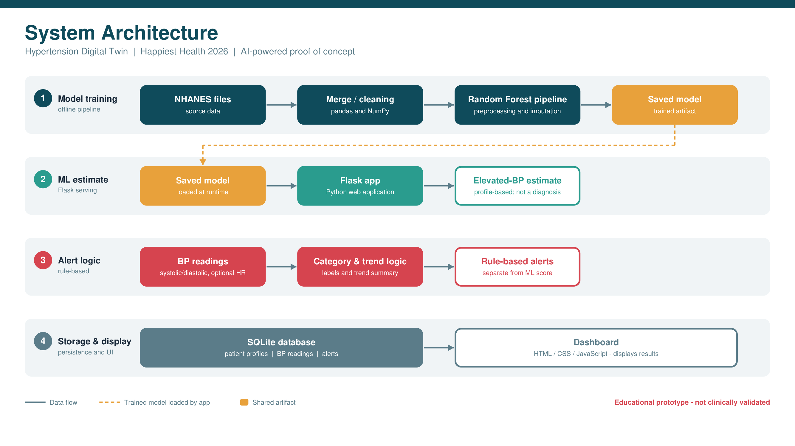

# Hypertension Digital Twin: AI-Assisted Blood Pressure Monitoring and Trend Analysis

An AI/ML-powered healthcare prototype for monitoring blood pressure readings, tracking patient history, and estimating the likelihood of elevated blood pressure from patient profile information.

---

## 1. Project Information

- **Project Title:** Hypertension Digital Twin
- **Challenge:** Happiest Health 2026 AI-Powered PoC/Digital Twin Challenge
- **Team Name:** 24pa1a4520
- **Project Type:** Individual Project
- **Team Leader and Developer:** Busi Mythili
- **College:** Vishnu Institute of Technology
- **Email:** [24pa1a4520@vishnu.edu.in](mailto:24pa1a4520@vishnu.edu.in)
- **Phone:** 7730809814
- **Repository:** [https://github.com/mythili7605/24pa1a4520_Vishnu_Institute_of_Technology](https://github.com/mythili7605/24pa1a4520_Vishnu_Institute_of_Technology)

---

## 2. Problem Statement

Hypertension, or high blood pressure, is a major global health concern that significantly elevates the risk of cardiovascular events, stroke, and chronic kidney disease. Regular blood pressure monitoring and access to understandable longitudinal health information can help individuals identify concerning trends early and seek timely medical care.

However, recording blood pressure measurements consistently over time, organizing patient histories, recognizing persistent elevations across readings, and interpreting risk estimates can be difficult without an integrated monitoring framework.

This project investigates how a digital-twin-inspired software system and machine learning can streamline blood pressure tracking, calculate trajectory trends, trigger clinical guideline screening alerts, and provide an educational estimate of the likelihood of elevated blood pressure.

---

## 3. Proposed Solution

The **Hypertension Digital Twin** is a web-based prototype combining patient profile management, longitudinal record keeping, trend trajectory estimation, and machine learning.

The application is designed to:
- Maintain patient demographic and physiological profiles.
- Record systolic and diastolic blood pressure readings with timestamps and heart rates.
- Display recorded readings, trajectory curves, and historical summaries.
- Classify blood pressure readings into ACC/AHA 2017 screening categories.
- Estimate the likelihood of elevated blood pressure using a trained Random Forest model.
- Present transparent model evaluation metrics and validation reports.

> **Disclaimer:** The application is an educational proof of concept. It is not a clinically validated digital twin and does not replace professional medical judgment or formal clinical diagnosis.

---

## 4. Healthcare Use Case

The prototype demonstrates an end-to-end workflow for digital blood pressure monitoring:
1. **Create or select a patient profile** with demographic and physiological attributes (age, BMI, waist circumference, height, diabetes status, etc.).
2. **Enter blood pressure measurements** over time (systolic, diastolic, heart rate, observational notes).
3. **View the patient's recorded history** and dynamic timeline graphs.
4. **Review the screening category** (Normal BP, Elevated BP, Stage 1 Range, Stage 2 Range, or Hypertensive Crisis Range) associated with the latest measurement.
5. **View the ML estimate** generated from the patient's profile features.
6. **Use the recorded longitudinal data and alerts** as an informed basis for consultation with a qualified healthcare professional.

> **Important Model Boundary:** The Random Forest model evaluates patient profile features (demographics, anthropometrics). Adding a new daily BP reading does not alter the patient's demographic profile, so the profile-based ML probability and the reading-based ACC/AHA classification operate as separate, complementary outputs.

---

## 5. Key Features

- **Patient Profile Management:** Comprehensive demographic and anthropometric tracking.
- **BP Reading Entry & Longitudinal History:** Timestamped logging of SBP, DBP, and pulse rate with notes.
- **SQLite Database Persistence:** Clean relational schema with atomic transactions and correlated subqueries for accurate latest-reading retrieval.
- **ACC/AHA 2017 BP Screening Classification:** Accurate categorization across Normal, Elevated, Stage 1, Stage 2, and Hypertensive Crisis ranges.
- **Trend Analysis Engine:** Least-squares linear regression measuring slope ($\text{mmHg/day}$) over recent readings, with robust handling for duplicate or irregular timestamps.
- **Multi-Rule Clinical Alert Generation:**
  - Hypertensive crisis range alerts with urgent medical evaluation guidance.
  - Stage 1 and Stage 2 screening alerts.
  - Persistent elevation alerts across consecutive readings.
  - Rising trend trajectory alerts ($>1.0\text{ mmHg/day}$).
  - Profile risk shift alerts upon factor changes.
- **Random Forest Likelihood Estimation:** Stratified pipeline trained on NHANES adult data without BP feature leakage.
- **Comprehensive Automated Validation:** 41 software checks covering data integrity, pipeline idempotency, edge cases, and alert firing rules.

---

## 6. Technology Stack

| Component | Technology |
|---|---|
| **Programming Language** | Python 3.11 |
| **Web Framework** | Flask |
| **Database** | SQLite (with foreign key enforcement) |
| **Machine Learning** | scikit-learn (RandomForestClassifier, Pipeline, ColumnTransformer) |
| **Data Processing** | pandas, NumPy |
| **Model Serialization** | joblib |
| **Frontend** | HTML5, CSS3, JavaScript (ES6+), Chart.js |
| **Dataset Format Support** | SAS Transport (`.xpt`) via pandas |
| **Testing & Validation** | Python test suites (`unittest` / custom verification scripts) |
| **Visualizations** | Matplotlib, Seaborn, Chart.js |

---

## 7. Dataset and Preprocessing

The machine learning model was developed using adult health survey data from the **National Health and Nutrition Examination Survey (NHANES)**.

- **Official Dataset Resource:** [CDC NHANES Data Portal](https://wwwn.cdc.gov/nchs/nhanes/)

The project processes data across five key NHANES modules:
- `P_DEMO.xpt`: Demographic variables (Age, Gender, Ethnicity, Education, Poverty Ratio).
- `P_BMX.xpt`: Body measurements (BMI, Waist circumference, Standing Height).
- `P_BPXO.xpt`: Blood pressure examination measurements (multiple SBP/DBP readings).
- `P_BPQ.xpt`: Blood pressure questionnaire responses (medication status).
- `P_DIQ.xpt`: Diabetes questionnaire responses.

### Preprocessing & Target Construction
1. Multiple blood pressure measurements (`BPXOSY1-3`, `BPXODI1-3`) are averaged to construct robust mean values (`SBP_mean`, `DBP_mean`).
2. **Target Label (`elevated_bp`):**
   - **Class 1 (Elevated BP):** $\text{SBP}_{\text{mean}} \ge 130\text{ mmHg} \lor \text{DBP}_{\text{mean}} \ge 80\text{ mmHg}$
   - **Class 0 (Normal BP):** $\text{SBP}_{\text{mean}} < 130\text{ mmHg} \land \text{DBP}_{\text{mean}} < 80\text{ mmHg}$
3. **Leakage Prevention:** Raw BP readings and mean BP variables are strictly excluded from the feature matrix $X$.
4. **Derived Feature:** Waist-to-Height Ratio ($\text{Waist} / \text{Height}$) is computed to capture central adiposity.
5. **Pipelines:** Numerical features are median-imputed and scaled via `StandardScaler`; categorical features are most-frequent imputed and one-hot encoded via `OneHotEncoder`.

---

## 8. Machine Learning Model

- **Algorithm:** Random Forest Classifier (`n_estimators=300`, `min_samples_leaf=4`, `class_weight='balanced'`)
- **Input Features ($11$ total):**
  - **Numeric ($6$):** Age, BMI, Waist circumference (cm), Height (cm), Waist-to-Height Ratio, Poverty Ratio.
  - **Categorical ($5$):** Sex, Ethnicity, Education Level, Diabetes Status, BP Medication Status.
- **Target Variable:** Binary `elevated_bp` (ACC/AHA 2017 Stage-1+ threshold).
- **Prediction Output:**
  - Probability estimate of Class 1 via `predict_proba`.
  - Non-diagnostic likelihood categorization:
    - $< 30\%$: *Lower predicted likelihood*
    - $30\% - 55\%$: *Moderate predicted likelihood*
    - $\ge 55\%$: *Higher predicted likelihood*

---

## 9. Model Evaluation

Evaluation results on the independent hold-out test set ($N = 1,605$ adult participants):

| Metric | Hold-out Score | Baseline Comparison |
|---|---|---|
| **Accuracy** | **65.61%** | +8.1% over Dummy Baseline (57.51%) |
| **Precision** | **57.79%** | — |
| **Recall (Sensitivity)** | **70.67%** | +70.7% over Dummy Baseline (0.00%) |
| **F1-Score** | **0.6359** | Balanced harmonic mean |
| **ROC-AUC** | **0.7225** | Strong discriminative ability |

### 5-Fold Stratified Cross-Validation
| CV Metric | Mean | Standard Deviation |
|---|---|---|
| **CV F1-Score** | **0.6247** | $\pm 0.0085$ |
| **CV ROC-AUC** | **0.7189** | $\pm 0.0123$ |

### Confusion Matrix
| Actual \ Predicted | Predicted Below Threshold (0) | Predicted Elevated BP (1) | Total |
|---|---|---|---|
| **Actual Below Threshold (0)** | **571** (TN) | **352** (FP) | 923 |
| **Actual Elevated BP (1)** | **200** (FN) | **482** (TP) | 682 |

### Evaluation Plots
- Confusion Matrix: [`confusion_matrix.png`](confusion_matrix.png)
- ROC Curve: [`roc_curve.png`](roc_curve.png)
- Feature Importance: [`feature_importance.png`](feature_importance.png)

---

## 10. System Architecture

The prototype follows a modular architecture separating model training, web API serving, persistence, and client presentation:



- **Vector PDF Format:** [View System Architecture PDF](docs/architecture.pdf)
- **High-Resolution Diagram:** [View Architecture PNG](docs/architecture.png)

### Key Architectural Layers:
1. **Model Training Pipeline (Offline):** Extracts NHANES `.xpt` tables, performs feature engineering without data leakage, trains the Random Forest pipeline, and serializes `rf_hypertension_model.pkl`.
2. **Flask Application (Backend):** Serves REST API routes for patient profiles, readings, trend analysis, and real-time alert evaluation.
3. **SQLite Database (Storage):** Enforces relational integrity across `patients`, `bp_readings`, and `alerts` tables with descending timestamp and reading ID ordering.
4. **Digital Twin Engine (Clinical Logic):** Evaluates ACC/AHA categories, computes multi-point least-squares slopes, and generates stratified alerts.
5. **Interactive Dashboard (Frontend):** Responsive interface with Chart.js visualizations, patient switching, and alert acknowledgment workflows.

---

## 11. Project Demonstration

- **Demonstration Video:** [Add your demonstration video link here]

### Recommended Demonstration Sequence:
1. Introduce the project context and clinical problem statement.
2. Outline the system architecture and technology stack.
3. Demonstrate creating and selecting virtual patient profiles.
4. Record new blood pressure readings and examine dynamic chart updates.
5. Explain the ACC/AHA screening categorization and emergency messaging.
6. Display the Random Forest likelihood gauge and explain feature contributions.
7. Demonstrate trend slope calculation and consecutive elevation alerts.
8. Review the 41-check automated validation test suite.

---

## 12. Project Presentation

The formal presentation slide deck for the Happiest Health 2026 challenge is available in the repository:

- **PowerPoint Presentation:** [View Project Presentation (PPTX)](docs/project_presentation.pptx)

---

## 13. Repository Structure

```text
24pa1a4520_Vishnu_Institute_of_Technology/
├── README.md                  # Comprehensive project documentation
├── LICENSE                    # MIT License file
├── requirements.txt           # Python dependency specifications
├── .gitignore                 # Excluded local databases and cache directories
├── app.py                     # Flask web server and API endpoints
├── database.py                # SQLite database interface & CRUD operations
├── twin_engine.py             # BP classification, trend estimation & alert rules
├── train_model.py             # Random Forest pipeline training script
├── test_digital_twin.py       # End-to-end 41-check validation suite
├── test_patient.py            # Single-patient profile test script
├── rf_hypertension_model.pkl  # Trained scikit-learn model artifact
├── evaluation_report.txt      # Model performance metrics on hold-out set
├── test_report.txt            # Test execution report
├── confusion_matrix.png       # Test set confusion matrix plot
├── roc_curve.png              # Test set ROC curve plot
├── feature_importance.png     # Random Forest feature importance plot
├── docs/                      # Documentation assets
│   ├── architecture.pdf       # System architecture diagram (vector PDF)
│   ├── architecture.png       # System architecture diagram (high-res image)
│   └── project_presentation.pptx # Project presentation slide deck
├── templates/
│   └── index.html             # Dashboard frontend HTML template
└── static/
    ├── css/dashboard.css      # Dashboard layout and styling
    └── js/dashboard.js        # Dashboard state, API calls & Chart.js rendering
```

---

## 14. Installation and Setup

### Prerequisites
- Python 3.11 or higher
- `pip` package manager
- `git`
- Modern web browser (Chrome, Edge, Firefox)

### Step 1: Clone the Repository
```bash
git clone https://github.com/mythili7605/24pa1a4520_Vishnu_Institute_of_Technology.git
cd 24pa1a4520_Vishnu_Institute_of_Technology
```

### Step 2: Create a Virtual Environment
**Windows PowerShell:**
```powershell
python -m venv .venv
.\.venv\Scripts\Activate.ps1
```

**Linux / macOS:**
```bash
python3 -m venv .venv
source .venv/bin/activate
```

### Step 3: Install Dependencies
```bash
python -m pip install --upgrade pip
pip install -r requirements.txt
```

### Step 4: Run the Application
```bash
python app.py
```
Open your browser and navigate to:
```
http://127.0.0.1:5000/
```

---

## 15. Testing & Validation

The repository includes a comprehensive, automated test suite:

```bash
python test_digital_twin.py
python test_patient.py
```

### Validation Suite Coverage (41/41 Passed):
- **Model Validation (A1–A7):** Pipeline loading, hold-out performance thresholds (Accuracy $>60\%$, Recall $>60\%$, ROC-AUC $>0.65$), dummy baseline comparisons, 5-fold cross-validation stability ($\text{std} < 0.05$), and zero-leakage feature verification.
- **Digital Twin Workflow Tests (B0–B7):** Database initialization, patient creation, reading storage, chronological sorting, and Stage 1 / Stage 2 classification.
- **Idempotency & Alert Tests (C1–C10):** Rolling averages, linear slope consistency, missing input handling, alert acknowledgment, and hypertensive crisis emergency alert firing.

---

## 16. Limitations

- **Educational Prototype:** This system is a proof-of-concept demonstration and has not undergone clinical validation or prospective clinical trials.
- **Population Representation:** Training data originates from NHANES survey participants and may reflect demographic distributions specific to the survey cohort.
- **Model False Positives / False Negatives:** With an accuracy of $65.6\%$ and precision of $57.8\%$, errors occur and must not influence unsupervised clinical care.
- **Input Independence:** The machine learning score reflects demographic and physical profile factors; it does not replace immediate, real-time blood pressure measurements.
- **Non-Diagnostic Scope:** Categorizations and probability scores are screening aids, not confirmed medical diagnoses.

---

## 17. Responsible Use and Safety

- **Clinical Guidance:** This software is intended strictly for educational demonstration and health monitoring research. It must never be used to diagnose medical conditions, prescribe treatments, or alter medications.
- **Emergency Symptoms:** Severely elevated blood pressure readings ($\text{SBP} \ge 180\text{ mmHg}$ or $\text{DBP} \ge 120\text{ mmHg}$) accompanied by symptoms such as chest pain, shortness of breath, back pain, numbness, weakness, vision changes, or difficulty speaking require **immediate emergency medical evaluation**.
- **Data Privacy:** Only synthetic demonstration records or appropriately de-identified cohort statistics should be stored or demonstrated. Identifiable patient health information (PHI) must never be committed to a public repository.

---

## 18. Future Improvements

- **Longitudinal Time-Series Modeling:** Incorporate recurrent architectures (LSTM) or temporal transformers to track multi-day BP trajectories directly into the risk forecast.
- **Probability Calibration:** Apply Platt scaling or isotonic regression to align model confidence with empirical clinical incidence rates.
- **External Multi-Cohort Validation:** Evaluate pipeline performance across diverse clinical datasets (e.g., MIMIC-IV, UK Biobank).
- **FHIR / EHR Interoperability:** Implement HL7 FHIR interfaces for standardized electronic health record integration.
- **Security & Authentication:** Add role-based access control (RBAC), encrypted database storage at rest, and audit logging.

---

## 19. License

This project is licensed under the **MIT License**. See the [LICENSE](LICENSE) file for complete details.

---

## 20. Acknowledgements

- **National Center for Health Statistics (NCHS), CDC:** For providing open-access NHANES survey data.
- **American College of Cardiology / American Heart Association (ACC/AHA):** For public clinical practice guidelines on blood pressure classification.
- **Open-Source Community:** Developers of Python, Flask, scikit-learn, pandas, NumPy, Chart.js, and Matplotlib.
- **Happiest Health 2026 Challenge:** For the problem framework and platform to explore AI-powered Digital Twin applications.

---

## 21. Contact

**Busi Mythili**  
Vishnu Institute of Technology  
- **Email:** [24pa1a4520@vishnu.edu.in](mailto:24pa1a4520@vishnu.edu.in)  
- **Phone:** +91 7730809814  
- **GitHub:** [@mythili7605](https://github.com/mythili7605)  
- **Repository:** [24pa1a4520_Vishnu_Institute_of_Technology](https://github.com/mythili7605/24pa1a4520_Vishnu_Institute_of_Technology)
